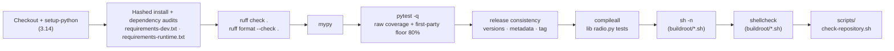

# Developing and contributing

This is the home for working on the **Python application** in this repository:
setting up a local environment, running the tests, and passing the linters and
type checks. None of this needs a Raspberry Pi — the hardware/system-only
libraries are stubbed, so the whole developer workflow runs on your workstation
(macOS, Linux) and in CI.

> Building the appliance **image** is a separate topic; see
> [`build-from-scratch.md`](build-from-scratch.md) and [`buildroot.md`](buildroot.md).
> To add a new playback backend, see
> [`adding-a-music-source.md`](adding-a-music-source.md).
> To change the parametric-EQ DSP, ALSA route or graph, see the developer section
> of [`equalizer.md`](equalizer.md#developer-architecture).

## Local setup

The application and its host tests use **Python 3.14**, matching the appliance.
Older Python versions are not supported. Dependencies are locked with hashes in
[`../requirements-dev.txt`](../requirements-dev.txt). Work inside a virtualenv:

```bash
cd pisonic
python3.14 -m venv .venv
source .venv/bin/activate
pip install --require-hashes -r requirements-dev.txt
```

`requirements-dev.in` selects host test/lint/type/security tooling plus the
runtime packages tested on the host. Its compiled lock shares constraints with
`requirements-runtime.txt`, compiled from `requirements.txt`, so tests exercise
the selected application versions without installing Pi-only drivers.

After reviewing an update, regenerate and audit both locks on Python 3.14:

```bash
python -m piptools compile --upgrade --generate-hashes --allow-unsafe \
  --strip-extras --output-file=requirements-runtime.txt requirements.txt
python -m piptools compile --upgrade --generate-hashes --allow-unsafe \
  --strip-extras requirements-dev.in
python -m pip_audit --strict --disable-pip --no-deps -r requirements-runtime.txt
python -m pip_audit --strict --disable-pip --no-deps -r requirements-dev.txt
```

Buildroot recipes and `buildroot/external/board/radio/python-security.mk` define
the actual firmware versions. Update and validate them too; regenerating a host
lock does not update an appliance. See [dependency security](dependency-security.md).

The hardware/system-only libraries — `RPi.GPIO`, `alsaaudio`, `dbus`, `spidev`,
`gpiozero`, `smbus2`, and the vendored ADS1115 driver — are stubbed in
[`../tests/conftest.py`](../tests/conftest.py). That is why the suite runs on
any machine **without a Raspberry Pi attached**.

## Running the tests

The suite under [`../tests/`](../tests/) is [pytest](https://docs.pytest.org/)
covering the pure logic: the `MusicSource` contract and its runtime
return-type enforcement, the `radio.conf` INI parser, the AirPlay metadata
parsing/decoding, the ALSA volume mapping, the ADS1115 ADC calibration math,
the display compositor, parametric-EQ validation/routing, and Buildroot LADSPA
package integration.

```bash
pytest
```

Test discovery and the import path are configured in
[`../pyproject.toml`](../pyproject.toml) (`tests/` is the test root and `lib/`
is added to `pythonpath`, so `from music_source import ...` resolves exactly as
it does at runtime, where `radio.py` does `sys.path.insert(0, .../lib)`).

To see the raw coverage scope, including the on-target display diagnostic
program:

```bash
pytest --cov --cov-report=term-missing
```

The raw number deliberately shows hardware/vendor gaps but is not a meaningful
application quality gate. After collecting coverage, generate the separate
first-party report with:

```bash
coverage report --omit='lib/display/display_test.py'
```

Only the standalone target-hardware diagnostic is excluded; hardware-facing
first-party adapters and panel drivers remain in the gate. CI requires **80%
first-party coverage**; raise this ratcheted floor as additional runtime paths
become safely testable on the host.

## Linting, formatting and type checks

The same `requirements-dev.txt` installs [`ruff`](https://docs.astral.sh/ruff/)
(lint + format) and [`mypy`](https://mypy-lang.org/) (static types):

```bash
ruff check .          # lint
ruff format --check . # verify the enforced formatting baseline
ruff format .         # apply formatting fixes
mypy                  # type-check all first-party production Python
python3 scripts/check-release-consistency.py  # release identity and tag policy
```

You can also install the [`pre-commit`](https://pre-commit.com/) hooks so these
run automatically on every commit (see
[`../.pre-commit-config.yaml`](../.pre-commit-config.yaml)):

```bash
pip install pre-commit
pre-commit install
```

- **ruff** targets Python 3.14 (`target-version = "py314"` in `pyproject.toml`),
  matching the appliance. Its version is aligned with pre-commit.
- **mypy** gates all first-party production Python in `radio.py`, `lib/`,
  `radio_web/`, and `scripts/`. It also checks bodies of legacy functions that
  do not yet have complete signatures. Hardware/system imports without host
  stubs are treated as external. The checker also targets Python 3.14.

## Continuous integration

Every push and pull request runs [`../.github/workflows/ci.yml`](../.github/workflows/ci.yml)
on Python 3.14. A weekly scheduled run also checks newly disclosed vulnerabilities
without waiting for a code change. The same local checks are enforced, plus
dependency audits and repository-wide shell/hygiene checks:



Run the Python-level checks locally before pushing to catch failures early:

```bash
ruff check . && ruff format --check . && mypy && pytest -q
```

## Module ownership and growth

Large subsystems are split by stable responsibility rather than by arbitrary
line count. Keep new behavior with its owning domain:

- `radio_web/routes.py` is the public dispatch facade; handlers belong in the
  `route_*` module for their administration area, with request/response contracts
  in `route_common.py`.
- `radio_web/templates.py` is the public rendering facade; page markup belongs
  in the corresponding `template_*` module and reusable escaped components in
  `template_common.py`.
- `lib/display/display_control.py` owns display state, scheduling, and panel I/O;
  artwork and transient pixel rendering belong in `display_rendering.py`.
- `radio_web/firmware_installer.py` owns trusted queue and worker lifecycle;
  restricted SWU/CPIO parsing belongs in `firmware_archive.py`.

The facades preserve existing imports. A new feature that crosses these
boundaries should include an explicit decomposition decision in its review
rather than growing a facade or combining unrelated responsibilities.

## The color-coded pinout HTML page

[`sound-devices.md`](sound-devices.md) is the Markdown source of truth for the
per-profile 40-pin maps. A color-coded HTML rendering is generated from it and
published to GitHub Pages at
<https://thk4711.github.io/pisonic/sound-devices.html>, where
each pin description is tinted by owning subsystem (SPI display, ADC, sound
card, amp GPIO, UART, free).

[`../scripts/generate-pinout-html.py`](../scripts/generate-pinout-html.py) reads
the `<!-- device:TAG -->` annotations in the Markdown and writes
[`sound-devices.html`](sound-devices.html):

```bash
python3 scripts/generate-pinout-html.py          # rebuild doc/sound-devices.html
python3 scripts/generate-pinout-html.py --check   # verify the HTML is up to date
```

After editing `sound-devices.md`, regenerate the HTML and commit both files.
[`../.github/workflows/pages.yml`](../.github/workflows/pages.yml) runs the
generator on every push to `main` and deploys the result to GitHub Pages.

## Developing the parametric equalizer

The EQ spans target C, generated ALSA configuration, persistent Python settings,
server-rendered HTML and browser response math. Start with
[`equalizer.md`](equalizer.md#developer-architecture), which documents the
component boundaries, invariants and synchronized changes required for filter
types and parameter ranges.

The focused host checks are:

```bash
pytest -q tests/test_equalizer.py tests/test_buildroot_equalizer.py \
  tests/test_web_audio_hardware.py tests/test_web_routes.py tests/test_web_helper.py
```

These do not replace on-device qualification. A host compiler can validate that
`radio_equalizer.c` is valid C, but the shipped module is cross-compiled for
ARMv7 by Buildroot and must be exercised through ALSA on the Pi. Verify all
music sources, EQ bypass, flat reset, the physical volume path, service recovery
after Apply, and positive-gain headroom before release.
